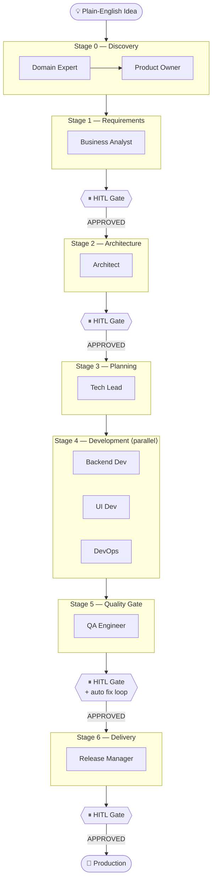

# SDLC Factory

An autonomous multi-agent software delivery pipeline. Give it a plain-English idea; it runs a sequence of AI specialist agents and produces a complete software delivery artifact at every stage — from domain glossary to Docker image — with configurable human-in-the-loop governance gates between stages.



---

## Quick start

**Requirements:** Python 3.11+, [`uv`](https://github.com/astral-sh/uv)

```bash
git clone <repo>
cd sdlc-factory
uv sync

export ANTHROPIC_API_KEY=sk-ant-...   # or OPENAI_API_KEY for OpenAI-compatible endpoints

# Preview the pipeline without making any API calls
python sdlc.py run "Build a FastAPI todo app with user auth" --dry-run

# Run the full pipeline (CLI approval prompts at each gate)
python sdlc.py run "Build a FastAPI todo app with user auth"

# Run fully automated (auto-approve all gates)
python sdlc.py run "Build a SaaS billing platform" --auto-approve

# Launch the Web UI dashboard (it prints a link with your access key; open that link)
python sdlc.py ui
# → http://127.0.0.1:7474/#token=<key>
```

Generated code and artifacts land in `./output/<run_id>/`. The SQLite state DB is at `~/.sdlc-factory/pipeline.db`.

---

## Installation

```bash
uv sync                        # core dependencies only
uv sync --extra anthropic      # + Anthropic SDK
uv sync --extra ui             # + Web UI (FastAPI + uvicorn)
uv sync --extra otel           # + OpenTelemetry tracing
uv sync --extra ui --extra dev # + Web UI + dev tools (pytest, ruff, black)
```

Or install as a package:

```bash
pip install -e .
sdlc run "Build a REST API"
```

---

## Environment variables

| Variable | Required | Purpose |
|---|---|---|
| `OPENAI_API_KEY` or `ANTHROPIC_API_KEY` | Yes | LLM credentials |
| `OPENAI_BASE_URL` or `ANTHROPIC_BASE_URL` | No | Point at any OpenAI-compatible endpoint |
| `SLACK_BOT_TOKEN` | No | Slack HITL gate mode |
| `HITL_WEBHOOK_URL` | No | Webhook HITL gate mode |
| `OTEL_TRACES_EXPORTER` | No | `otlp`, `console`, or unset (silent) |
| `OTEL_EXPORTER_OTLP_ENDPOINT` | No | OTLP collector endpoint (e.g. `http://localhost:4317`) |
| `OTEL_SERVICE_NAME` | No | Service name tag on all spans (default: `sdlc-factory`) |

---

## CLI reference

```bash
# Start a new run
python sdlc.py run "Build a FastAPI todo app" [--config sdlc_config.yaml]
                                               [--model claude-opus-4-8]
                                               [--workspace ./output]
                                               [--auto-approve]
                                               [--dry-run]
                                               [--tenant <tenant-id>]

# Resume a paused run
python sdlc.py resume <run_id> [--config sdlc_config.yaml]

# Check run status
python sdlc.py status <run_id>

# View kanban board (terminal)
python sdlc.py kanban <run_id>

# Approve / reject / amend a gate from the CLI
python sdlc.py approve <run_id> <stage> [--decision APPROVED|REJECTED|AMENDED]
                                         [--rationale "looks good"]
                                         [--amended-artifact '{"key":"val"}']
                                         [--resume]

# Show per-stage token usage and estimated cost
python sdlc.py cost <run_id>

# Build Docker image and print deployment checklist
python sdlc.py deliver <run_id> [--no-docker] [--smoke-test]

# Show audit log
python sdlc.py audit <run_id>

# List recent runs
python sdlc.py list [--limit 20] [--tenant <tenant-id>]

# Export all stage artifacts for a run to disk
python sdlc.py export <run_id> [--output-dir ./output]

# Launch the Web UI dashboard
python sdlc.py ui [--host 127.0.0.1] [--port 7474] [--reload] [--allow-remote]
```

---

## Web UI

The Web UI is a React single-page dashboard served by a FastAPI backend. Install the `ui` extra first:

```bash
uv sync --extra ui
python sdlc.py ui
# → http://127.0.0.1:7474/#token=<key>
```

### Access

Every API request needs a per-launch access key, so a web page you happen to have open cannot approve pipeline stages. `python sdlc.py ui` prints it once:

```
Dashboard ready. Open this link (it includes your access key):
http://127.0.0.1:7474/#token=<key>
Keep this terminal open. Anyone with the link can approve stages, so do not share it. Restarting makes a new link.
```

- **Open that link.** The page keeps the key for that browser tab only and removes it from the address bar. A bookmark, a second tab, or a restarted server shows the "Dashboard locked" or "Session ended" screen: open the new link from your terminal, or paste it into the field on that screen.
- **Treat the link like a password.** Anyone who has it can approve stages. Restarting `sdlc.py ui` makes a new one.
- **Loopback only by default.** `--host 0.0.0.0` (or any non-loopback address) is refused unless you pass `--allow-remote`. The key still gates the API, but the connection is plain HTTP.
- **Running uvicorn directly** needs the key in the environment: `SDLC_UI_TOKEN=<key> uvicorn gateway.web_server:app`. The app refuses to start without it.

**Features:**
- **Run list** with live status badges and auto-refresh every 5 seconds
- **Summary stats** — Total / Running / Completed / Failed / Paused counts
- **Pipeline visualisation** — 7-stage progress bar with per-stage status, HITL gate indicators, and connecting lines
- **Stage detail panel** with four tabs:
  - **Artifact** — syntax-highlighted JSON viewer with one-click copy
  - **Kanban** — 4-column task board (Pending / In Progress / Blocked / Done)
  - **Audit Log** — timeline of every HITL gate decision
  - **Cost** — per-stage token usage and USD cost breakdown with bar chart
- **HITL Approval modal** — Approve / Reject / Amend directly from the browser with inline JSON editor for amendments
- **Toast notifications** after approval actions

The API is also accessible at `/api/docs` (FastAPI auto-generated Swagger UI).

---

## Pipeline stages

| Stage | Agents | HITL gate |
|---|---|---|
| `discovery` | Domain Expert, Product Owner | — |
| `requirements` | Business Analyst | Yes |
| `architecture` | Architect | Yes |
| `planning` | Tech Lead | — |
| `development` | Backend Dev, UI Dev, DevOps (parallel) | — |
| `quality_gate` | QA Engineer | Yes (+ auto fix loop) |
| `delivery` | Release Manager | Yes |

Each stage agent produces a JSON artifact validated against its output schema. Artifacts accumulate in an `ArtifactBundle` that is injected into every downstream agent's system prompt as structured context.

---

## Configuration

Copy `config/pipeline_config.yaml` to `sdlc_config.yaml` and pass `--config sdlc_config.yaml`:

```yaml
pipeline:
  model: claude-sonnet-4-6          # default model for all agents
  max_iterations_per_agent: 30
  workspace: ./output

agents:
  architect:
    model: claude-opus-4-8          # stronger model for ADRs
    max_iterations: 50

governance:
  default_mode: cli                 # cli | auto | slack | webhook | queue
  hitl_gates:
    - stage: requirements
      mode: cli
    - stage: quality_gate
      mode: auto
      coverage_threshold: 80        # auto-approve if coverage >= 80%

parallel:
  max_concurrent_developers: 4
  subagent_auto_approve: false

context_compression:
  enabled: true
  model: claude-haiku-4-5
  threshold_tokens: 30000
  keep_recent: 6
```

---

## HITL governance

Five approval modes are supported per stage gate:

| Mode | Behaviour |
|---|---|
| `cli` | Interactive terminal prompt — approve / reject / amend |
| `auto` | Rule-based: coverage threshold, max open questions |
| `slack` | Posts to a Slack channel; waits for emoji reaction |
| `webhook` | POSTs artifact to a URL; waits for callback |
| `queue` | Programmatic — blocks on an `ApprovalQueue` |

Gate decisions:
- **APPROVED** — pipeline advances
- **REJECTED** — run pauses (`status=paused`); resume with `sdlc resume <run_id>`
- **AMENDED** — artifact is mutated in-place, downstream stages cleared, pipeline advances with the new artifact

HITL gates can also be resolved from the Web UI — click **Review Gate** on any paused stage.

---

## Security

The pipeline applies several layers of protection:

| Layer | Mechanism |
|---|---|
| **Prompt injection scanning** | `scan_for_injection()` is called on the idea string before any DB state is created. It matches 6 pattern families: role override, persona hijack, system-role injection, fence-tag injection, jailbreak keywords, and prompt exfiltration. Raises `PromptInjectionError` on a match. |
| **Path traversal** | All agent file writes are validated to stay inside `output/<run_id>/`. |
| **Credential isolation** | API keys loaded from env only; never written to artifacts. |
| **Subagent isolation** | Developer agents cannot call `send_message`, `memory` (write), or `delegate_task`. |
| **Audit log** | Every HITL decision written to `audit_log` with timestamp and actor. |

---

## QA fix loop

When the QA gate finds critical bugs, the pipeline automatically:

1. Groups bugs by related task and dispatches the original developer agent to fix them
2. Re-runs the QA engineer
3. Repeats up to `qa.max_fix_iterations` times (default: 3)
4. On exhaustion, stamps `escalated_to_hitl=true` on the artifact and hands off to the HITL gate

---

## Agent model recommendations

| Role | Recommended model | Reason |
|---|---|---|
| `architect` | `claude-opus-4-8` | Complex ADR reasoning |
| All others | `claude-sonnet-4-6` | Code generation, cost/quality balance |
| Compression auxiliary | `claude-haiku-4-5` | Fast, cheap summarisation |

---

## Enterprise features

### Multi-tenant isolation

Run isolated pipelines for different tenants on the same database:

```bash
python sdlc.py run "Build an API" --tenant acme
python sdlc.py list --tenant acme
```

Per-tenant credentials are loaded from `~/.sdlc-factory/tenants/<tenant-id>.env`:

```bash
# ~/.sdlc-factory/tenants/acme.env
OPENAI_API_KEY=sk-acme-...
OPENAI_BASE_URL=https://acme-endpoint.example.com
```

### Provider failover

Configure multiple API keys for automatic round-robin failover on rate limits:

```bash
export OPENAI_API_KEY_0=sk-key-1
export OPENAI_API_KEY_1=sk-key-2
export OPENAI_API_KEY_2=sk-key-3
```

`call_model_with_failover()` rotates keys on `429 rate limit`, backs off on `5xx`, and raises immediately on context-length or auth errors.

### Context compression

Automatically compresses long agent conversation histories when token usage exceeds a threshold. Configure in `sdlc_config.yaml`:

```yaml
context_compression:
  enabled: true
  model: claude-haiku-4-5
  threshold_tokens: 30000
  keep_recent: 6
```

### OpenTelemetry tracing

Install the `otel` extra and set `OTEL_TRACES_EXPORTER` to emit spans:

```bash
uv sync --extra otel
export OTEL_TRACES_EXPORTER=otlp
export OTEL_EXPORTER_OTLP_ENDPOINT=http://localhost:4317
export OTEL_SERVICE_NAME=sdlc-factory
python sdlc.py run "Build an API"
```

Three span levels are emitted:

| Span | Attributes |
|---|---|
| `sdlc.pipeline.run` | `run_id`, `idea`, `outcome` |
| `sdlc.stage.<name>` | `run_id`, `stage`, `parallel`, `outcome`, `gate.decision`, `gate.mode` |
| `sdlc.agent.<role>` | `run_id`, `stage`, `role`, `agent_id` |

If the `opentelemetry-sdk` package is not installed the pipeline falls back to no-op spans silently.

### Skill library

Agents can retrieve pre-built architecture pattern fragments via `skill_view`:

```
skills/library/rest-api.md       — REST API design patterns
skills/library/event-driven.md   — Event sourcing, CloudEvents, outbox pattern
skills/library/microservices.md  — Service boundaries, resilience, observability
```

Add the `skills` toolset to any agent's `ENABLED_TOOLSETS` to make these available.

### Custom agent roles

Define new roles in YAML files under `custom_roles/`:

```yaml
# custom_roles/data-engineer.yaml
role: data_engineer
display_name: Data Engineer
authority_statement: You design and implement data pipelines and ETL jobs.
max_iterations: 35
enabled_toolsets: [read_file, write_file, terminal, execute_code]
prior_stages: [discovery, requirements, architecture, planning]
output_schema:
  type: object
  required: [pipeline_steps, schemas_created]
  properties:
    pipeline_steps: {type: array, items: {type: object}}
    schemas_created: {type: array, items: {type: string}}
```

Custom roles are registered automatically at pipeline startup. Reference them in `SDLC_STAGES` or custom stage definitions.

### GitHub integration

DevOps agents have access to `gh` CLI tools (`gh_create_pr`, `gh_merge_pr`, `gh_request_review`, `gh_list_prs`) via the `github` toolset. Requires the [GitHub CLI](https://cli.github.com) installed and authenticated.

---

## Project structure

```
sdlc-factory/
├── sdlc.py                    # CLI entry point (run, resume, status, ui, cost, …)
├── core/
│   ├── pipeline.py            # Stage machine (SDLCPipeline), async artifact writer
│   ├── agent_base.py          # BaseSDLCAgent, AgentConfig, IterationBudget
│   ├── agent_runtime.py       # call_model_openai, CredentialPool, failover
│   ├── session.py             # PipelineDB (SQLite WAL, multi-tenant)
│   ├── memory.py              # ArtifactBundle, ProjectMemory, scan_for_injection
│   ├── telemetry.py           # OpenTelemetry spans (pipeline / stage / agent)
│   ├── qa_loop.py             # QA auto-fix loop orchestrator
│   ├── context_compressor.py  # ContextCompressor (haiku-based summarisation)
│   ├── skill_library.py       # Skill fragment resolver
│   └── tenant.py              # TenantConfig — per-tenant credentials
├── agents/
│   ├── roles.py               # All 10 built-in agent role classes
│   └── custom_loader.py       # YAML custom role loader
├── gateway/
│   ├── hitl.py                # HITLGateway, AutoEvaluator, ApprovalQueue
│   └── web_server.py          # FastAPI backend for the Web UI
├── ui/
│   └── index.html             # React SPA dashboard (CDN, no build step)
├── tools/
│   ├── _context.py            # Thread-local workspace/DB context for tools
│   ├── skill_tools.py         # skill_list, skill_view
│   ├── pytest_tool.py         # run_pytest (JUnit XML + coverage)
│   ├── docker_tool.py         # docker_build, docker_run
│   └── github_tool.py         # gh_create_pr, gh_merge_pr, gh_request_review, gh_list_prs
├── skills/
│   ├── library/               # Built-in SKILL.md pattern fragments
│   └── <role>/SKILL.md        # Role-specific instructions (optional, auto-loaded)
├── custom_roles/              # YAML custom role definitions (*.yaml)
├── config/
│   └── pipeline_config.yaml   # Reference configuration
├── docs/
│   ├── PRODUCT_SPEC.md
│   ├── TECH_ARCHITECTURE.md
│   ├── AGENT_ROLES.md
│   └── IMPLEMENTATION_ROADMAP.md
└── tests/                     # Unit + integration tests (no API calls required)
```

---

## Development

```bash
# Install dev dependencies
uv sync

# Install all extras together
uv sync --extra ui --extra otel --extra anthropic --extra dev

# Run all tests
uv run pytest

# Run a single test class
uv run pytest tests/test_pipeline_unit.py::TestPipelineDB

# Lint and format
uv run ruff check .
uv run black .
```

### Adding an agent role

1. Subclass `BaseSDLCAgent` in `agents/roles.py` — set `ROLE`, `ROLE_DISPLAY`, `OUTPUT_SCHEMA`, `ENABLED_TOOLSETS`, override `prior_stages()`
2. Create `skills/<role-name>/SKILL.md` with the role's instructions
3. Add to `AGENT_ROLE_MAP` at the bottom of `agents/roles.py`
4. Reference the role string in a `StageDefinition` in `SDLC_STAGES` (`core/pipeline.py`)

Or drop a YAML file into `custom_roles/` for zero-code role definitions.

### Adding a tool

Create `tools/<toolname>.py` and register at module level:

```python
from core.registry import registry

registry.register(
    name="my_tool",
    handler=my_fn,
    schema={"type": "function", "function": {"name": "my_tool", ...}},
    toolset="my_toolset",
)
```

`discover_tools()` imports all tool modules automatically. Import errors are logged as warnings and do not crash startup.

---

## Observability

Every agent run records token usage to the `token_usage` SQLite table. View cost breakdown per stage:

```bash
python sdlc.py cost <run_id>

# Cost breakdown — run run-a1b2c3d4
#
# Stage                Role                   Model                  Tokens In  Tokens Out  Cost (USD)
# ---------------------------------------------------------------------------------------------------------
# discovery            domain_expert          claude-sonnet-4-6         12,450       3,200      $0.0853
# discovery            product_owner          claude-sonnet-4-6         14,100       4,800      $0.1143
# ...
# TOTAL                                                                 98,300      28,400      $0.7197
```

The same data is available in the Web UI under the **Cost** tab of any stage.

All HITL decisions are written to `audit_log` and retrievable via `sdlc audit <run_id>` or the **Audit Log** tab in the Web UI.

---

## License

MIT
