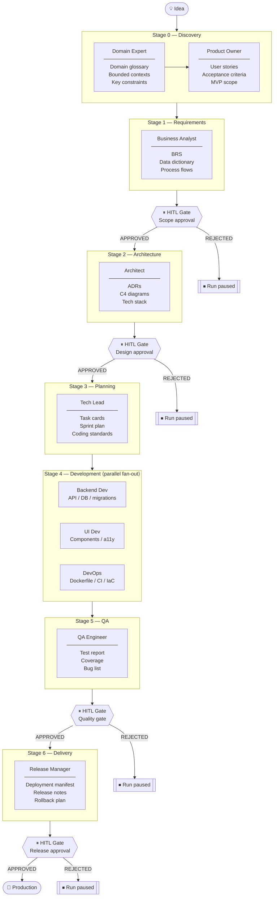

# SDLC Factory — Product Specification

## Vision

An autonomous AI software factory that transforms business ideas into
production-ready software through a coordinated pipeline of specialized agents.
Each agent represents a real software-delivery role (Domain Expert, Product Owner,
Business Analyst, Architect, Tech Lead, Developer, QA), operates within defined
authority boundaries, and hands structured artifacts to downstream agents — all
with configurable human-in-the-loop governance gates.

---

## Problem Statement

Enterprise software delivery suffers from three chronic failures:

1. **Translation loss** — requirements degrade between business stakeholders,
   analysts, architects, and developers. Each handoff introduces ambiguity.
2. **Slow feedback loops** — defects discovered late cost 10–100× more than
   defects caught at requirements time.
3. **Coordination overhead** — synchronising cross-functional teams consumes
   more calendar time than the actual work.

LLMs are strong enough to simulate each specialist role. What is missing is a
structured *coordination protocol* that routes the right context to the right
agent, enforces artifacts at stage gates, and keeps a human in the loop for
decisions above a configurable risk threshold.

---

## Agent Roles

| Role | Authority | Input | Output artifact |
|---|---|---|---|
| **Domain Expert** | Business domain knowledge | Raw idea / business context | Domain glossary, bounded context map |
| **Product Owner** | Backlog ownership | Domain glossary | Prioritised user stories, acceptance criteria, MVP scope |
| **Business Analyst** | Requirements specification | User stories | BRS (requirements spec), data dictionary, process flows |
| **Architect** | System design | BRS, tech constraints | ADR set, C4 architecture diagrams, tech stack decision |
| **Tech Lead** | Implementation strategy | ADR, task backlog | Sprint plan, task breakdown, coding standards, PR checklist |
| **Developer — UI** | Frontend code | Task card | Component code, Storybook stories, accessibility annotations |
| **Developer — Backend** | API / service code | Task card | Service code, OpenAPI spec, DB migrations |
| **Developer — DevOps** | Infrastructure / CI | ADR, service code | Dockerfile, Helm chart, CI pipeline, IaC |
| **QA Engineer** | Quality assurance | All artifacts + code | Test plan, automated test suite, coverage report, bug report |
| **Release Manager** | Delivery orchestration | QA gate pass | Release notes, deployment manifest, rollback plan |

---

## SDLC Workflow Stages



---

## MVP Feature Set

### MVP-1: Core Pipeline (Week 1–3)
- Single-run pipeline: Idea → Requirements → Architecture → Task breakdown
- All agents run sequentially with artifact hand-off via shared context
- SQLite-backed session store; artifact versioning per stage
- CLI entry point: `sdlc run "build a todo app in FastAPI"`

### MVP-2: Parallel Development (Week 4–6)
- Task cards dispatched to developer agents in parallel (ThreadPoolExecutor)
- Per-task isolated terminal sessions
- Kanban board: `sdlc kanban status`
- Code written to an output workspace directory

### MVP-3: HITL Governance (Week 7–8)
- Configurable approval gates at stages 1, 2, 5, 6
- Approval via CLI interactive prompt, Slack, or webhook
- Gate outcomes recorded in audit log

### MVP-4: QA Loop (Week 9–10)
- QA agent generates pytest suite from BRS acceptance criteria
- Auto-runs tests in sandbox; feeds failures back to developer agents
- Max 3 fix iterations before escalation

### MVP-5: Delivery (Week 11–12)
- DevOps agent generates Dockerfile + GitHub Actions CI
- Release Manager produces CHANGELOG + deployment checklist
- `sdlc deliver` command triggers full pipeline to production-ready package

---

## User Stories

```
US-001  As a founder, I can describe my product idea in plain English and receive
        a prioritised backlog within 5 minutes.

US-002  As a CTO, I can review and approve the architecture document before any
        code is generated.

US-003  As a developer, I can see which agent is working on which task and
        interrupt it without affecting other parallel agents.

US-004  As a QA lead, I can configure the minimum test coverage threshold; the
        pipeline halts and escalates if the threshold is not met.

US-005  As an operator, I can replay any failed stage from its last persisted
        artifact without re-running upstream stages.

US-006  As a security officer, I can see the full audit log of every agent
        decision and every tool call, with PII hashed in logs.

US-007  As an enterprise user, I can extend the pipeline with custom agent roles
        by providing a YAML role definition and a SKILL.md file.
```

---

## Non-Functional Requirements

| Category | Requirement |
|---|---|
| Latency | Stage 0 (Discovery) completes in < 3 min on GPT-4o-class models |
| Cost | Full pipeline run (simple CRUD app) costs < $2 at current API prices |
| Reliability | Pipeline checkpoint-resumes from last completed stage on crash |
| Security | No secrets written to artifact files; credentials loaded from env only |
| Observability | Structured JSON log per agent turn; OpenTelemetry span per stage |
| Extensibility | New agent role = one Python file + one SKILL.md, zero core changes |
| Portability | Runs on macOS, Linux, Docker; no cloud account required for MVP |
| Auditability | Every HITL decision timestamped, actor-tagged, stored immutably |

---

## Configuration Model

```yaml
# sdlc_config.yaml
pipeline:
  model: claude-sonnet-4-6          # default model for all agents
  max_iterations_per_agent: 30
  workspace: ./output               # where artifacts are written
  checkpoint: true

agents:
  architect:
    model: claude-opus-4-7          # override for expensive reasoning roles
    max_iterations: 50
  developer_ui:
    toolsets: [files, terminal, browser]
  developer_backend:
    toolsets: [files, terminal, web]
  qa:
    toolsets: [files, terminal, execute_code]

governance:
  hitl_gates:
    - stage: requirements
      mode: cli                     # cli | slack | webhook | auto
    - stage: architecture
      mode: cli
    - stage: quality_gate
      mode: auto                    # auto-approve if coverage >= threshold
      coverage_threshold: 80
    - stage: release
      mode: slack
      slack_channel: "#releases"

parallel:
  max_concurrent_developers: 4
  developer_timeout_seconds: 600

memory:
  project_memory: ./output/PROJECT_MEMORY.md
  shared_glossary: ./output/GLOSSARY.md
```

---

## Risk Register

| Risk | Likelihood | Impact | Mitigation |
|---|---|---|---|
| LLM hallucinations in architecture | Medium | High | Human-in-the-loop gate at arch stage |
| Cost overrun from large codebases | Medium | Medium | Per-stage token budget enforcement |
| Context window overflow mid-pipeline | High | High | Stage-based context compression |
| Circular dependencies in task graph | Low | High | DAG validation before dispatch |
| Prompt injection via user requirements | Medium | High | Input scanning before injection |
