# SDLC Factory — Technical Guide

> **Audience**: Engineers extending, deploying, or debugging the system.
> This guide covers architecture, data flows, component internals, the security
> model, observability, and every extension point.

---

## Table of Contents

1. [Overview](#1-overview)
2. [System Architecture](#2-system-architecture)
3. [Pipeline Mechanics](#3-pipeline-mechanics)
4. [Agent Model](#4-agent-model)
5. [Agent Roles Reference](#5-agent-roles-reference)
6. [Parallel Development Stage](#6-parallel-development-stage)
7. [Three-Tier Memory System](#7-three-tier-memory-system)
8. [HITL Governance](#8-hitl-governance)
9. [Tool Registry](#9-tool-registry)
10. [State Store — SQLite](#10-state-store--sqlite)
11. [Model Runtime](#11-model-runtime)
12. [Context Compression](#12-context-compression)
13. [Security Model](#13-security-model)
14. [Observability](#14-observability)
15. [Web UI](#15-web-ui)
16. [Configuration Reference](#16-configuration-reference)
17. [Extension Guide](#17-extension-guide)
18. [End-to-End Data Flow](#18-end-to-end-data-flow)
19. [Project Structure](#19-project-structure)

---

## 1. Overview

SDLC Factory is an autonomous multi-agent software delivery pipeline. It accepts
a plain-English idea and routes it through ten specialist AI agents arranged in a
seven-stage pipeline. Each agent operates within a defined authority boundary,
produces a validated JSON artifact, and passes structured context to downstream
agents. Human-in-the-loop (HITL) gates pause the pipeline at configurable stages
for human review before advancing.

### Problem it solves

Enterprise software delivery has three chronic failures:

| Failure | Symptom | SDLC Factory response |
|---|---|---|
| Translation loss | Requirements degrade between stakeholders, analysts, architects, devs | Structured artifact contracts enforced at every stage boundary |
| Slow feedback loops | Defects found late cost 10–100× more | QA loop runs continuously; agent bugs → auto-fix → re-verify |
| Coordination overhead | Cross-functional sync consumes more time than actual work | Parallel developer dispatch with a kanban board as coordination protocol |

### High-level pipeline

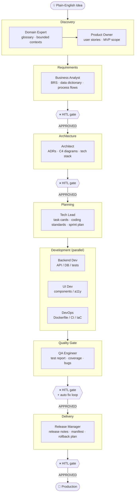

---

## 2. System Architecture

### Layer map

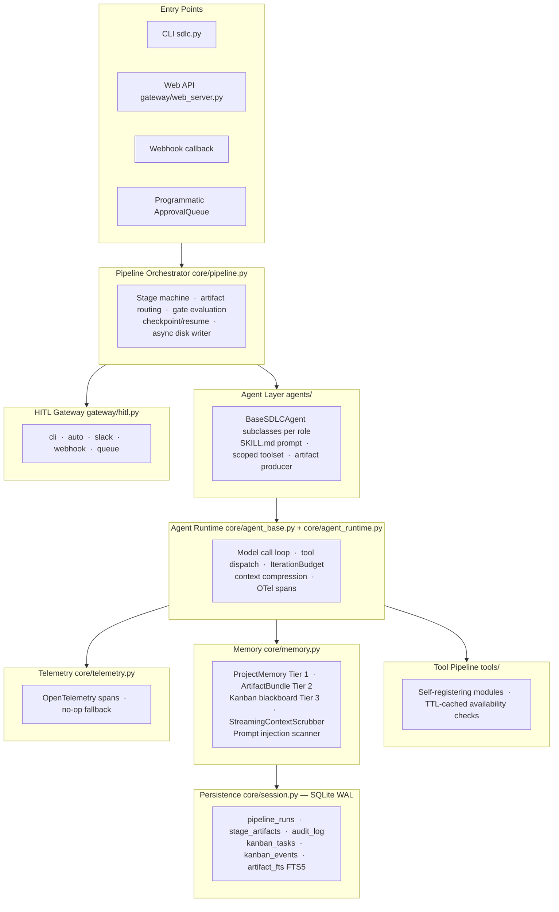

### Core design principles

| Principle | Implementation |
|---|---|
| Separation of concerns | Agents never call each other directly — all communication goes through `ArtifactBundle` |
| Artifact-first | Every stage must produce a JSON artifact validated against an output schema before the pipeline advances |
| Fail-safe by default | Invalid artifacts and failed stages pause the run (`status=paused`) instead of crashing silently |
| No shared mutable state | Parallel developer agents get fresh message histories; coordination is through the kanban board only |
| Zero-dependency core | Core pipeline runs without optional extras (`ui`, `otel`) installed |

---

## 3. Pipeline Mechanics

### Stage machine (`core/pipeline.py`)

`SDLCPipeline.run(idea)` drives a linear list of `StageDefinition` objects:

```python
@dataclass
class StageDefinition:
    name: str              # canonical identifier used in DB + artifact bundle
    agent_roles: list[str] # role keys to invoke (from AGENT_ROLE_MAP)
    parallel: bool = False # fan-out to ThreadPoolExecutor
    hitl_gate: bool = False# pause for human approval after this stage
```

`SDLC_STAGES` (defined at module level) is the authoritative ordering:

| Index | Name | Roles | Parallel | HITL |
|---|---|---|---|---|
| 0 | `discovery` | domain_expert, product_owner | No | No |
| 1 | `requirements` | business_analyst | No | **Yes** |
| 2 | `architecture` | architect | No | **Yes** |
| 3 | `planning` | tech_lead | No | No |
| 4 | `development` | developer_backend, developer_ui, developer_devops | **Yes** | No |
| 5 | `quality_gate` | qa_engineer | No | **Yes** |
| 6 | `delivery` | release_manager | No | **Yes** |

### Execution loop

```mermaid
flowchart TD
    START([pipeline.run idea]) --> INJ["scan_for_injection idea\nraises PromptInjectionError if matched"]
    INJ --> DB1["create_run run_id, idea\nDB write"]
    DB1 --> MEM1["write PROJECT_MEMORY stub"]
    MEM1 --> SPAN["pipeline_span run_id, idea"]

    SPAN --> LOOP{"for each stage\nin SDLC_STAGES"}
    LOOP -->|already completed| SKIP["skip\nresume path"]
    SKIP --> LOOP

    LOOP -->|not completed| SSTAGE["stage_span run_id, stage.name"]
    SSTAGE --> PAR{stage.parallel?}

    PAR -->|yes| PAR_RUN["_run_parallel_stage\nThreadPoolExecutor max_workers=N\none task per role, results merged"]
    PAR -->|no|  SEQ_RUN["_run_sequential_stage\nfor each role:\n  agent_span → agent.run"]

    PAR_RUN & SEQ_RUN --> VAL["Validate artifact\nagainst OUTPUT_SCHEMA"]
    VAL --> BUNDLE["bundle.add stage, artifact\ndb.save_artifact\n_write_artifact_to_disk async"]

    BUNDLE --> GATE{stage.hitl_gate?}
    GATE -->|no| LOOP
    GATE -->|yes| HITL["hitl.request_approval\nstage, artifact"]
    HITL -->|APPROVED| LOOP
    HITL -->|REJECTED| PAUSE(["⏸ pause run\nstatus = paused"])
    HITL -->|AMENDED| AMD["mutate artifact in-place\nclear downstream stages"]
    AMD --> LOOP
```

### Checkpoint and resume

Every completed stage writes its artifact to the `stage_artifacts` DB table.
On `pipeline.run("", resume_run_id=<id>)`, the pipeline reads all previously
completed artifacts into the bundle and starts from the first non-completed stage.

```python
# Resume example
pipeline.run("", resume_run_id="run-7e2fc67b")
# → loads discovery + requirements + architecture artifacts from DB
# → resumes at planning stage
```

### Async artifact disk writer

Artifact JSON is also written to `output/<run_id>/artifacts/<stage>.json` for
portability. The write is submitted to a single-worker `ThreadPoolExecutor`
(`self._disk_writer`), so it never blocks the calling pipeline thread:

```python
def _write_artifact_to_disk(self, run_id, stage, artifact):
    # JSON serialised in calling thread to avoid shared-state races
    payload = json.dumps(artifact, indent=2)
    self._disk_writer.submit(self._do_write, run_id, stage, payload)
```

The single worker serialises all writes to avoid concurrent file stomping.

---

## 4. Agent Model

### `BaseSDLCAgent` (`core/agent_base.py`)

Every agent role is a thin subclass that declares five class-level attributes:

```python
class ArchitectAgent(BaseSDLCAgent):
    ROLE           = "architect"
    ROLE_DISPLAY   = "Architect"
    OUTPUT_SCHEMA  = {...}         # JSON Schema for the artifact this role produces
    ENABLED_TOOLSETS = ["read_file", "web_search", "write_file", "memory"]
    SKILL_MD_PATH  = "skills/architect/SKILL.md"

    def prior_stages(self) -> list[str]:
        return ["discovery", "requirements"]
```

### What `BaseSDLCAgent.run()` does

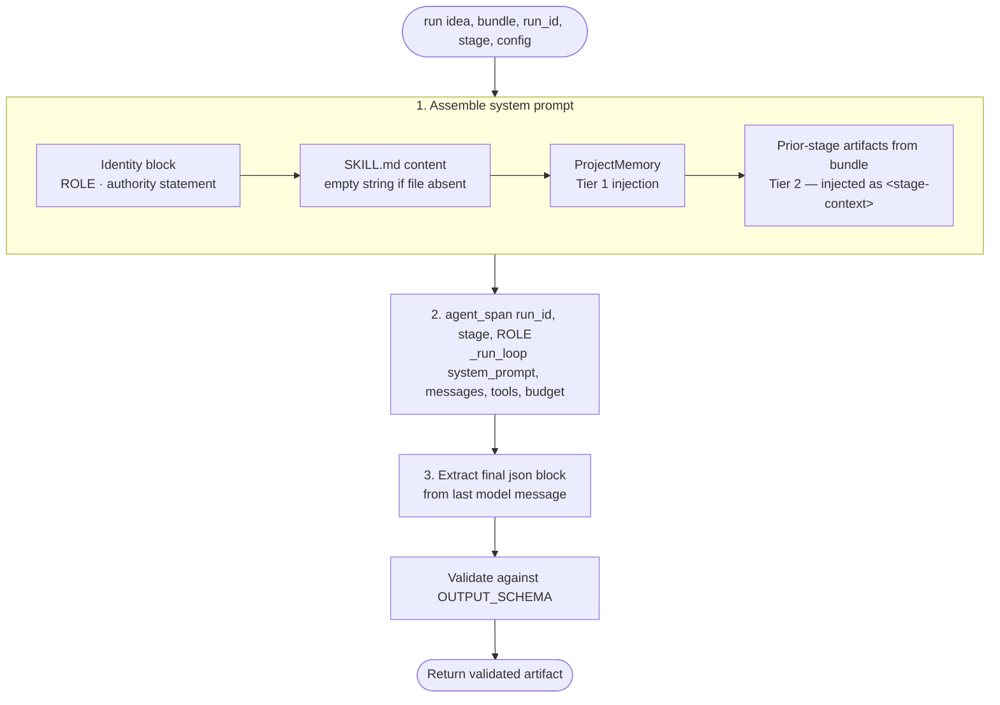

### Tool calling loop (`_run_loop`)

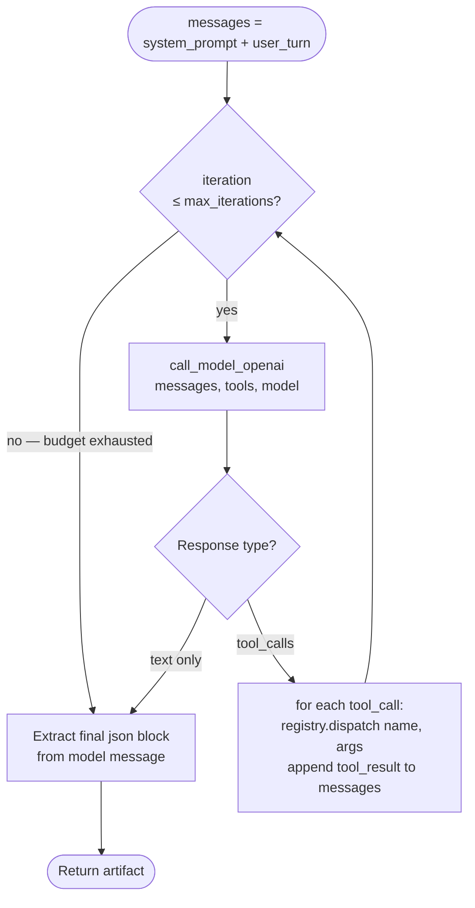

### IterationBudget

Prevents runaway agents. Each role has a default; config can override per-role:

| Role | Default `max_iterations` |
|---|---|
| developer_* | 30 |
| architect | 50 |
| All others | 20 |

When the budget is exhausted the agent emits its best-effort artifact from the
last message rather than raising an exception, so the pipeline can continue.

---

## 5. Agent Roles Reference

### Discovery stage

#### Domain Expert
| Field | Value |
|---|---|
| **Authority** | Business domain knowledge; bounded context decomposition |
| **Inputs** | Raw `idea` string + any reference docs |
| **Output** | `discovery.domain` — glossary, bounded contexts, constraints, out-of-scope |
| **Toolset** | `web_search`, `read_file`, `memory`, `write_file` |

```json
{
  "glossary": {"<term>": "<definition>"},
  "bounded_contexts": [
    {"name": "...", "entities": [...], "responsibilities": "..."}
  ],
  "key_constraints": ["..."],
  "out_of_scope": ["..."]
}
```

#### Product Owner
| Field | Value |
|---|---|
| **Authority** | Backlog ownership; user story prioritisation; MVP scope |
| **Inputs** | `discovery.domain` |
| **Output** | `discovery.product` — user stories (As a / I can / So that), acceptance criteria (Gherkin), MVP scope |
| **Toolset** | `read_file`, `memory`, `write_file` |

```json
{
  "user_stories": [
    {
      "id": "US-001",
      "story": "As a ... I can ... so that ...",
      "priority": "must|should|could|wont",
      "acceptance_criteria": ["Given ... When ... Then ..."]
    }
  ],
  "mvp_stories": ["US-001"],
  "mvp_rationale": "..."
}
```

### Requirements stage

#### Business Analyst
| Field | Value |
|---|---|
| **Authority** | Requirements specification; data modelling; process flows |
| **Inputs** | `discovery.domain`, `discovery.product` |
| **Output** | `requirements` — numbered FRs, NFRs, data dictionary, process flows, open questions |
| **Toolset** | `read_file`, `memory`, `write_file` |
| **HITL gate** | Human approves BRS before architecture begins |

### Architecture stage

#### Architect
| Field | Value |
|---|---|
| **Authority** | System design; technology selection; architectural decisions |
| **Inputs** | `requirements` + config tech constraints |
| **Output** | `architecture` — ADR set, C4 diagrams (PlantUML/Mermaid), tech stack, API style, auth strategy |
| **Toolset** | `read_file`, `web_search`, `write_file`, `memory` |
| **HITL gate** | Human approves architecture before planning begins |
| **Model** | `claude-opus-4-8` recommended (complex ADR reasoning) |

ADR structure:
```json
{
  "id": "ADR-001",
  "title": "Use PostgreSQL over DynamoDB",
  "status": "accepted",
  "context": "...",
  "options_considered": ["PostgreSQL", "DynamoDB", "MongoDB"],
  "decision": "PostgreSQL",
  "consequences": {"positive": ["..."], "negative": ["..."]}
}
```

### Planning stage

#### Tech Lead
| Field | Value |
|---|---|
| **Authority** | Implementation strategy; task decomposition; coding standards |
| **Inputs** | `architecture`, `requirements` |
| **Output** | `planning` — task cards, coding standards, sprint plan |
| **Toolset** | `read_file`, `write_file`, `memory`, `kanban_create` |

Each task card:
```json
{
  "task_id": "t-001",
  "title": "Implement User model + migration",
  "assignee_role": "developer_backend",
  "description": "...",
  "acceptance_criteria": ["..."],
  "dependencies": [],
  "estimated_turns": 10,
  "skills": ["python", "sqlalchemy", "alembic"]
}
```

### Development stage (parallel)

All three developer roles run concurrently. Each agent receives a fresh message
history (no cross-agent context leak). They share only the kanban board.

#### Developer — Backend
| Field | Value |
|---|---|
| **Authority** | API / service code; business logic; DB schemas + migrations |
| **Inputs** | Single task card + `architecture` + `requirements` |
| **Output** | `development.<task_id>` — files written, tests passing, coverage %, PR description |
| **Toolset** | `read_file`, `write_file`, `patch`, `terminal`, `search_files`, `memory` |
| **Blocked** | `delegate_task`, `send_message`, `clarify`, shared-memory writes |

#### Developer — UI
| Field | Value |
|---|---|
| **Authority** | Frontend components; accessibility; browser behaviour |
| **Inputs** | Single UI task card + `architecture` + design tokens |
| **Output** | Same as Backend + `storybook_stories`, `accessibility_notes` |
| **Toolset** | `read_file`, `write_file`, `patch`, `terminal`, `browser_navigate`, `browser_click`, `browser_type`, `search_files` |

#### Developer — DevOps
| Field | Value |
|---|---|
| **Authority** | Infrastructure; CI/CD; containerisation; IaC |
| **Inputs** | `architecture`, `planning.coding_standards` |
| **Output** | `development.devops` — Dockerfile, docker-compose, GitHub Actions, Terraform/Helm |
| **Toolset** | `read_file`, `write_file`, `patch`, `terminal`, `search_files` |

### Quality Gate stage

#### QA Engineer
| Field | Value |
|---|---|
| **Authority** | Quality assurance; test planning; bug reporting; gate decision |
| **Inputs** | Full artifact bundle (all stages) + workspace file tree |
| **Output** | `quality_gate` — test plan, suite results, coverage %, bugs, gate decision |
| **Toolset** | `read_file`, `write_file`, `terminal`, `execute_code`, `search_files` |
| **HITL gate** | If `gate_passed=false`, human decides fix / waive / halt |

QA gate output:
```json
{
  "total_tests": 47, "passing": 47, "failing": 0,
  "coverage_pct": 88,
  "bugs": [],
  "acceptance_criteria_coverage": {"US-001": "covered"},
  "gate_passed": true,
  "gate_rationale": "All must-have AC covered; coverage 88% ≥ 80%"
}
```

**QA fix loop** — when `gate_passed=false`:

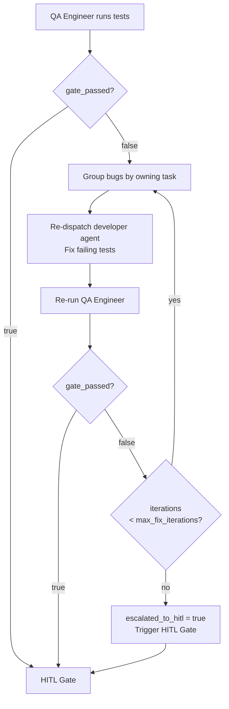

### Delivery stage

#### Release Manager
| Field | Value |
|---|---|
| **Authority** | Delivery orchestration; release notes; rollback plan |
| **Inputs** | Full artifact bundle + QA gate approval |
| **Output** | `delivery` — version, release notes, deployment checklist, rollback procedure, release tag |
| **Toolset** | `read_file`, `write_file`, `terminal`, `memory` |
| **HITL gate** | Human approves before deployment manifest is finalised |

---

## 6. Parallel Development Stage

### Fan-out topology

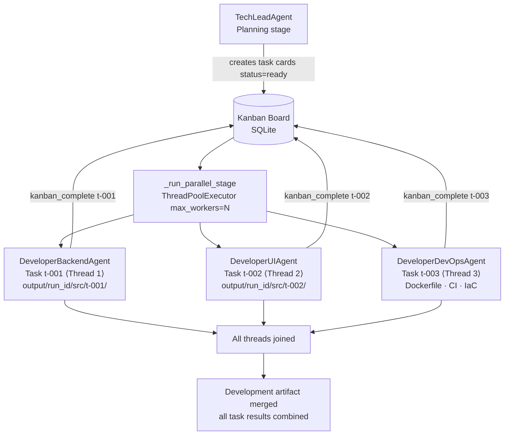

### Per-agent isolation guarantees

| Isolation | Mechanism |
|---|---|
| No cross-agent message history | Each agent gets a fresh `messages=[]` list |
| No shared file system writes | Each agent scoped to `output/<run_id>/src/<task_id>/` |
| No recursive delegation | `delegate_task` in `AGENT_BLOCKED_TOOLS_DEFAULT` |
| Kanban board as coordination | Agents signal completion via `kanban_complete` only |

### Kanban task lifecycle

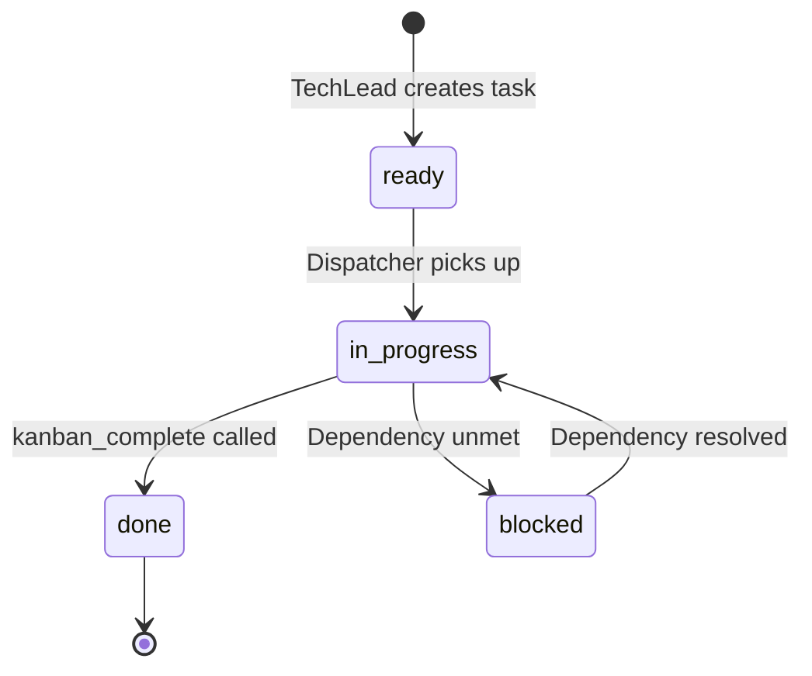

---

## 7. Three-Tier Memory System

### Tier 1 — Project Memory (`core/memory.py::ProjectMemory`)

A single `PROJECT_MEMORY.md` file in the workspace root. Written by the Domain
Expert; read by every subsequent agent. Injected into the **system prompt** of
every agent on every turn:

```
--- PROJECT MEMORY ---
{contents of PROJECT_MEMORY.md}
--- END ---
```

Format: YAML frontmatter + Markdown sections (glossary, decisions, conventions).

### Tier 2 — Artifact Bundle (`core/memory.py::ArtifactBundle`)

An in-memory dict accumulated across stages:

```python
bundle = ArtifactBundle()
bundle.add("discovery", {"domain": {...}, "product": {...}})
bundle.add("requirements", {...})
# ...
agent.run(idea, artifact_bundle=bundle, ...)
```

Each agent declares `prior_stages()` — only those artifacts are injected, saving
context budget. Injected as a fenced context block:

```
<stage-context>
{
  "discovery": {...},
  "requirements": {...}
}
</stage-context>
```

The `StreamingContextScrubber` removes these fences from model output to prevent
accidental artifact leakage into the visible response.

### Tier 3 — Kanban Blackboard (SQLite `kanban_tasks` + `kanban_events`)

Ephemeral within a pipeline run. Developer agents post structured JSON comments
to task rows. The QA verifier reads these to build an integration picture.
Discarded (or archived) after the pipeline completes.

---

## 8. HITL Governance

### `HITLGateway` (`gateway/hitl.py`)

Five modes, configured per stage in `sdlc_config.yaml`:

| Mode | Behaviour | Use case |
|---|---|---|
| `cli` | Blocks the pipeline thread; prints artifact summary; reads `y/n/edit` from stdin | Local development |
| `auto` | `AutoEvaluator` applies rule set (coverage threshold, max open questions); no human needed | CI / automated pipelines |
| `slack` | POSTs artifact summary to channel; polls for ✅ / ❌ reaction | Async team review |
| `webhook` | POSTs artifact JSON to a URL; blocks on `ApprovalQueue.get()` | Custom approval tooling |
| `queue` | Programmatic API: `queue.approve(run_id, stage, decision)` | Testing / embedding |

```mermaid
flowchart TD
    PL[Pipeline] --> EVAL["PipelineGate.evaluate\nstage · artifact"]
    EVAL --> MODE{Gate mode}

    MODE -->|auto|    AE["AutoEvaluator\ncoverage threshold\nmax open questions"]
    MODE -->|cli|     CL["Print summary\nRead stdin y/n/edit"]
    MODE -->|slack|   SL["POST to channel\nPoll for reaction"]
    MODE -->|webhook| WH["POST to URL\nPoll for callback"]
    MODE -->|queue|   QU["Block on\nApprovalQueue"]

    AE & CL & SL & WH & QU --> DEC{Decision}

    DEC -->|APPROVED| ADV[Advance pipeline]
    DEC -->|REJECTED| HALT["status = paused\nSurface to operator"]
    DEC -->|AMENDED|  AMD["Update artifact in DB\nClear downstream stages\nPartial re-run"]

    ADV & HALT & AMD --> LOG[("audit_log")]
```

### Gate decisions

```python
class Decision(Enum):
    APPROVED = "APPROVED"   # pipeline advances
    REJECTED = "REJECTED"   # run.status → paused; pipeline halts
    AMENDED  = "AMENDED"    # artifact mutated in-place; downstream stages cleared
```

**AMENDED flow** (most complex):
1. Human submits new JSON for the artifact via CLI / Web UI / webhook
2. `db.update_artifact(run_id, stage, new_artifact)` overwrites the DB row
3. `db.clear_stages_after(run_id, stage, stage_order)` deletes all downstream artifacts
4. Pipeline re-runs from the amended stage with the corrected artifact
5. Audit log records: `decision=AMENDED, actor=<who>, rationale=<why>`

### Audit log

Every gate decision is written immutably:

```sql
INSERT INTO audit_log (run_id, stage, decision, actor, rationale, timestamp)
VALUES (?, ?, ?, ?, ?, datetime('now'));
```

Actor format: `cli:<username>`, `slack:<user_id>`, `auto`, `ui:web`.

---

## 9. Tool Registry

### Self-registration pattern (`core/registry.py`)

Tool modules register themselves at import time:

```python
# tools/file_tools.py
from core.registry import registry

registry.register(
    name      = "read_file",
    handler   = read_file_fn,       # callable(args: dict) → str
    schema    = {                   # JSON Schema (OpenAI tool format)
        "type": "function",
        "function": {
            "name": "read_file",
            "description": "...",
            "parameters": {...}
        }
    },
    toolset   = "files",            # logical group name
    check_fn  = lambda: True,       # TTL-cached availability check (30s)
    emoji     = "📂",
)
```

`discover_tools()` (called at pipeline startup) walks `tools/` and imports every
module. Import errors are caught, logged as warnings, and do not crash startup.

### Toolset scoping

`agent.run()` calls `registry.get_definitions(enabled_toolsets=[...])` to build
the tool list for each agent. Only tools whose `toolset` is in the agent's
`ENABLED_TOOLSETS` are visible to the model. Blocked tools (from
`AGENT_BLOCKED_TOOLS_DEFAULT`) are never included regardless of toolset.

### Tool dispatch

```python
result = registry.dispatch(tool_name, tool_args)
# dispatch() looks up the handler, calls it, returns the result string
```

---

## 10. State Store — SQLite

### Entity-relationship diagram

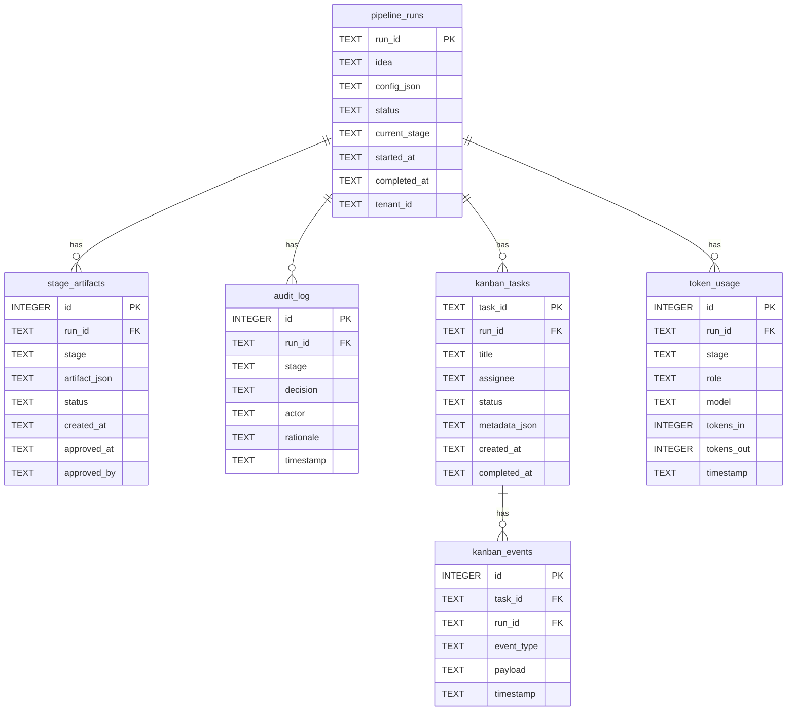

### Schema (`core/session.py`)

```sql
-- Pipeline runs
CREATE TABLE pipeline_runs (
    run_id        TEXT PRIMARY KEY,
    idea          TEXT NOT NULL,
    config_json   TEXT,
    status        TEXT DEFAULT 'running',  -- running | completed | failed | paused
    current_stage TEXT,
    started_at    TEXT,
    completed_at  TEXT,
    tenant_id     TEXT,
    SCHEMA_VERSION INTEGER DEFAULT 1
);

-- Stage artifacts — one row per stage per run
CREATE TABLE stage_artifacts (
    id            INTEGER PRIMARY KEY AUTOINCREMENT,
    run_id        TEXT REFERENCES pipeline_runs(run_id),
    stage         TEXT NOT NULL,
    artifact_json TEXT NOT NULL,
    status        TEXT DEFAULT 'pending', -- pending | approved | rejected | amended
    created_at    TEXT,
    approved_at   TEXT,
    approved_by   TEXT
);

-- Full-text search on artifact content
CREATE VIRTUAL TABLE artifact_fts USING fts5(
    run_id, stage, content,
    content='stage_artifacts', content_rowid='id'
);

-- HITL audit log
CREATE TABLE audit_log (
    id        INTEGER PRIMARY KEY AUTOINCREMENT,
    run_id    TEXT,
    stage     TEXT,
    decision  TEXT,       -- APPROVED | REJECTED | AMENDED
    actor     TEXT,
    rationale TEXT,
    timestamp TEXT
);

-- Kanban tasks (development stage)
CREATE TABLE kanban_tasks (
    task_id       TEXT PRIMARY KEY,
    run_id        TEXT,
    title         TEXT,
    assignee      TEXT,   -- developer_ui | developer_backend | developer_devops
    status        TEXT,   -- ready | in_progress | done | blocked
    metadata_json TEXT,
    created_at    TEXT,
    completed_at  TEXT
);

-- Kanban task events (state transitions)
CREATE TABLE kanban_events (
    id         INTEGER PRIMARY KEY AUTOINCREMENT,
    task_id    TEXT,
    run_id     TEXT,
    event_type TEXT,
    payload    TEXT,
    timestamp  TEXT
);

-- Token usage (per agent turn)
CREATE TABLE token_usage (
    id          INTEGER PRIMARY KEY AUTOINCREMENT,
    run_id      TEXT,
    stage       TEXT,
    role        TEXT,
    model       TEXT,
    tokens_in   INTEGER,
    tokens_out  INTEGER,
    timestamp   TEXT
);
```

### WAL mode and retry

`PipelineDB` opens the connection with `PRAGMA journal_mode=WAL` for concurrent
read access during parallel development. Writes use a jittered exponential
backoff retry loop to handle SQLite `SQLITE_BUSY` / `SQLITE_LOCKED` errors from
concurrent developer threads:

```python
for attempt in range(MAX_RETRIES):
    try:
        return fn()
    except sqlite3.OperationalError as e:
        if "locked" in str(e) and attempt < MAX_RETRIES - 1:
            time.sleep(jitter(BASE_DELAY * 2 ** attempt))
        else:
            raise
```

### Multi-tenant isolation

Every `pipeline_runs` row has a `tenant_id` column. `list_runs()` and
`get_run()` filter by tenant when a tenant context is active. Per-tenant
credentials are loaded from `~/.sdlc-factory/tenants/<tenant-id>.env`.

---

## 11. Model Runtime

### `call_model_openai()` (`core/agent_runtime.py`)

The sole place that calls the LLM. Uses the `openai` SDK with a lazily
initialised client (saves ~240ms cold start on first agent invocation):

```python
response = client.chat.completions.create(
    model    = model,
    messages = messages,
    tools    = tools or NOT_GIVEN,
    stream   = False,
)
```

The `base_url` parameter makes this compatible with any OpenAI-compatible
provider: Anthropic, Azure OpenAI, Mistral, local Ollama, etc.

### Provider failover (`CredentialPool`)

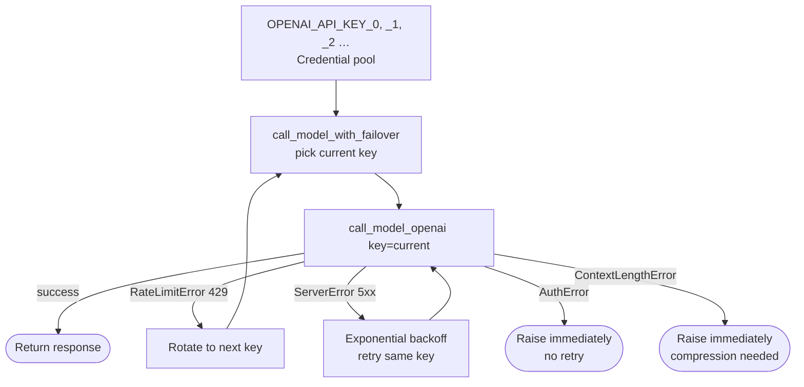

### Model recommendations

| Role | Default model | Reason |
|---|---|---|
| `architect` | `claude-opus-4-8` | Complex multi-step ADR reasoning |
| All developer roles | `claude-sonnet-4-6` | Code generation quality / cost balance |
| All other roles | `claude-sonnet-4-6` | Structured text, fast |
| Context compressor | `claude-haiku-4-5` | Cheap, fast, summarisation-only |

---

## 12. Context Compression

### `ContextCompressor` (`core/context_compressor.py`)

Long-running developer agents can produce conversation histories that exceed
the model context window. The compressor:

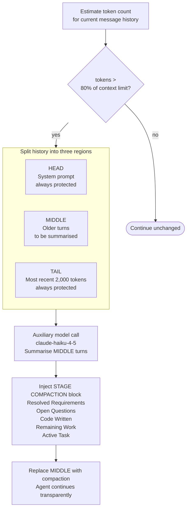

---

## 13. Security Model

### Prompt injection scanning

`scan_for_injection(text)` is called on the idea string in `pipeline.run()`
**before any DB state is created**. It raises `PromptInjectionError` on match:

| Pattern name | What it catches | Regex (simplified) |
|---|---|---|
| `role_override` | "ignore / forget your previous instructions" | `\b(ignore|override)\b.{0,40}\b(previous|prior)\b.{0,40}\b(instructions?)\b` |
| `persona_hijack` | "you are now / act as / pretend to be" | `\b(you are now|act as|pretend to be)\b` |
| `system_role_injection` | Lines starting with `system:` / `user:` / `assistant:` | `^\s*(system|user|assistant)\s*:\s*\S` |
| `fence_tag_injection` | Attempts to inject `<stage-context>` tags | `<\s*stage-context` |
| `jailbreak_keyword` | "jailbreak", "DAN mode", "developer mode" | `\b(jailbreak|DAN mode)\b` |
| `prompt_exfiltration` | "reveal / print your system prompt" | `\b(reveal|print)\b.{0,30}\b(your system prompt)\b` |

### Path traversal guard

All tool file writes call `validate_within_dir(path, workspace_root)` which
resolves symlinks and verifies the canonical path starts with the workspace:

```python
resolved = Path(path).resolve()
if not str(resolved).startswith(str(workspace_root.resolve())):
    raise SecurityError(f"Path traversal attempt: {path}")
```

Agents are confined to `output/<run_id>/`.

### Subagent tool blocking

`AGENT_BLOCKED_TOOLS_DEFAULT` (set in `core/agent_base.py`) is always applied
regardless of the agent's `ENABLED_TOOLSETS`:

```python
AGENT_BLOCKED_TOOLS_DEFAULT = {"clarify", "send_message", "delegate_task"}
```

These prevent developer agents from spawning sub-agents or attempting recursive
delegation.

### Credential isolation

- API keys are never written to artifact JSON or log files
- The `audit_log.actor` field records only the role/channel, not credentials
- PII in log lines is SHA-256 hashed before emission

---

## 14. Observability

### Structured per-turn logs

Every agent turn emits a structured JSON log line to `stdout`:

```json
{
  "ts"                   : "2026-06-01T10:00:00Z",
  "run_id"               : "run-a1b2c3d4",
  "stage"                : "architecture",
  "agent"                : "architect",
  "turn"                 : 4,
  "tool_calls"           : ["read_file", "write_file"],
  "tokens_in"            : 8420,
  "tokens_out"           : 1200,
  "cost_usd"             : 0.042,
  "iteration_budget_used": 4,
  "iteration_budget_max" : 50
}
```

### OpenTelemetry spans (`core/telemetry.py`)

Three span levels form a hierarchy:

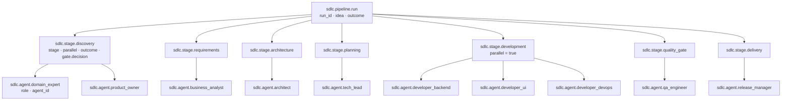

| Span name | Key attributes |
|---|---|
| `sdlc.pipeline.run` | `run_id`, `idea` (truncated 200 chars), `outcome` |
| `sdlc.stage.<name>` | `run_id`, `stage`, `parallel`, `outcome`, `gate.decision`, `gate.mode` |
| `sdlc.agent.<role>` | `run_id`, `stage`, `role`, `agent_id` |

**Graceful degradation**: if `opentelemetry-sdk` is not installed, `get_tracer()`
returns a `_NoOpTracer` that implements the same context-manager interface, so
the pipeline runs without any changes.

**Enabling OTel tracing**:
```bash
uv sync --extra otel
export OTEL_TRACES_EXPORTER=otlp
export OTEL_EXPORTER_OTLP_ENDPOINT=http://localhost:4317
export OTEL_SERVICE_NAME=sdlc-factory
python sdlc.py run "..."
```

Supported exporters: `otlp` (gRPC), `console` (stdout JSON), or unset (silent).

### Cost tracking

Token usage is stored per agent turn in the `token_usage` table. Cost is
calculated server-side using model-specific pricing:

| Model | Input (per 1M tokens) | Output (per 1M tokens) |
|---|---|---|
| claude-opus-4-8 | $15.00 | $75.00 |
| claude-sonnet-4-6 | $3.00 | $15.00 |
| claude-haiku-4-5 | $0.25 | $1.25 |
| gpt-4o | $2.50 | $10.00 |
| gpt-4o-mini | $0.15 | $0.60 |

View from CLI: `python sdlc.py cost <run_id>`  
View from Web UI: **Cost** tab in any stage detail panel.

---

## 15. Web UI

### Backend (`gateway/web_server.py`)

A FastAPI application served by uvicorn. Start it with:

```bash
uv sync --extra ui
python sdlc.py ui [--host 127.0.0.1] [--port 7474] [--reload]
```

#### REST API endpoints

| Method | Path | Description |
|---|---|---|
| `GET` | `/api/runs?limit=N` | List pipeline runs (most recent first) |
| `GET` | `/api/runs/{run_id}` | Run detail including stage statuses |
| `GET` | `/api/runs/{run_id}/stages` | Stage statuses only |
| `GET` | `/api/runs/{run_id}/artifacts/{stage}` | Raw artifact JSON for a stage |
| `GET` | `/api/runs/{run_id}/kanban` | Kanban task list for the run |
| `GET` | `/api/runs/{run_id}/audit` | Audit log for the run |
| `GET` | `/api/runs/{run_id}/cost` | Token usage + cost breakdown |
| `POST` | `/api/runs/{run_id}/approve` | Submit HITL gate decision |
| `GET` | `/api/docs` | FastAPI Swagger UI |
| `GET` | `/{any}` | React SPA catch-all (serves `ui/index.html`) |

#### Approve endpoint payload

```json
{
  "stage"            : "architecture",
  "decision"         : "APPROVED",          // APPROVED | REJECTED | AMENDED
  "rationale"        : "LGTM",
  "amended_artifact" : {...}                 // required only when decision=AMENDED
}
```

#### Stage status derivation

`_stage_statuses(run_id)` joins the `stage_artifacts` table with the `SDLC_STAGES`
list to produce a status for every stage, even those not yet started:

```python
if stage in completed_artifacts:
    status = artifact_row["status"]           # approved | rejected | amended | pending
elif stage == current_stage and run.status == "running":
    status = "running"
else:
    status = "pending"
```

### Frontend (`ui/index.html`)

A React 18 single-page application loaded via CDN (no build step). External
dependencies:

| Library | Source | Purpose |
|---|---|---|
| React 18 | unpkg.com | UI framework |
| Babel Standalone | unpkg.com | JSX transpilation in-browser |
| Tailwind CSS | cdn.tailwindcss.com | Utility CSS |
| highlight.js | cdnjs | JSON syntax highlighting |
| Inter font | Google Fonts | Typography |
| JetBrains Mono font | Google Fonts | Monospace (JSON, IDs) |

#### Component tree

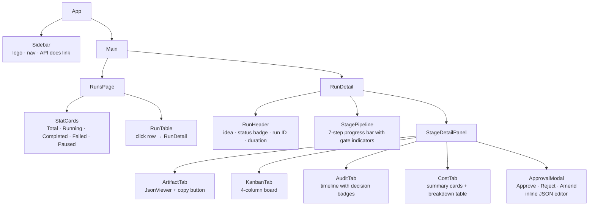

Auto-refresh polls `/api/runs` and `/api/runs/{run_id}` every 5 seconds
using `setInterval` inside `useEffect` — no WebSocket required.

---

## 16. Configuration Reference

Full annotated schema (`config/pipeline_config.yaml`):

```yaml
pipeline:
  model: claude-sonnet-4-6          # Default model for all agents
  max_iterations_per_agent: 30      # IterationBudget cap
  workspace: ./output               # Base directory for code + artifact files
  checkpoint: true                  # Persist artifacts to SQLite for resume

agents:
  architect:
    model: claude-opus-4-8          # Per-role model override
    max_iterations: 50
  developer_ui:
    toolsets: [files, terminal, browser]
  developer_backend:
    toolsets: [files, terminal, web]
  qa:
    toolsets: [files, terminal, execute_code]

governance:
  default_mode: cli                 # Fallback gate mode
  hitl_gates:
    - stage: requirements
      mode: cli                     # cli | auto | slack | webhook | queue
    - stage: architecture
      mode: cli
    - stage: quality_gate
      mode: auto
      coverage_threshold: 80        # Auto-approve if coverage% >= this
    - stage: delivery
      mode: slack
      slack_channel: "#releases"

parallel:
  max_concurrent_developers: 4      # ThreadPoolExecutor workers
  developer_timeout_seconds: 600    # Per-agent wall-clock timeout
  subagent_auto_approve: false

context_compression:
  enabled: true
  model: claude-haiku-4-5           # Auxiliary summarisation model
  threshold_tokens: 30000           # Trigger at 80% of this
  keep_recent: 6                    # Number of recent turns to protect

memory:
  project_memory: ./output/PROJECT_MEMORY.md
  shared_glossary: ./output/GLOSSARY.md

qa:
  max_fix_iterations: 3             # Fix loop cap before HITL escalation

observability:
  log_level: INFO
  otel_enabled: false               # Override with OTEL_TRACES_EXPORTER env var
```

---

## 17. Extension Guide

### Adding an agent role (Python)

1. **Subclass** `BaseSDLCAgent` in `agents/roles.py`:

```python
class SecurityReviewerAgent(BaseSDLCAgent):
    ROLE             = "security_reviewer"
    ROLE_DISPLAY     = "Security Reviewer"
    ENABLED_TOOLSETS = ["read_file", "search_files", "execute_code"]
    SKILL_MD_PATH    = "skills/security-reviewer/SKILL.md"
    OUTPUT_SCHEMA    = {
        "type": "object",
        "required": ["findings", "severity", "gate_passed"],
        "properties": {
            "findings": {"type": "array", "items": {"type": "object"}},
            "severity": {"type": "string", "enum": ["low","medium","high","critical"]},
            "gate_passed": {"type": "boolean"},
        }
    }

    def prior_stages(self) -> list[str]:
        return ["discovery", "requirements", "architecture", "planning", "development"]
```

2. **Create** `skills/security-reviewer/SKILL.md` with role instructions.

3. **Register** in `AGENT_ROLE_MAP` at the bottom of `agents/roles.py`:

```python
AGENT_ROLE_MAP["security_reviewer"] = SecurityReviewerAgent
```

4. **Add** a stage to `SDLC_STAGES` in `core/pipeline.py`:

```python
StageDefinition(
    name="security_review",
    agent_roles=["security_reviewer"],
    hitl_gate=True,
),
```

### Adding an agent role (YAML — zero Python)

Drop a file into `custom_roles/`:

```yaml
# custom_roles/data-engineer.yaml
role: data_engineer
display_name: Data Engineer
authority_statement: You design and implement data pipelines and ETL jobs.
max_iterations: 35
enabled_toolsets: [read_file, write_file, terminal, execute_code]
prior_stages: [discovery, requirements, architecture, planning]
output_schema:
  type: object
  required: [pipeline_steps, schemas_created]
  properties:
    pipeline_steps: {type: array, items: {type: object}}
    schemas_created: {type: array, items: {type: string}}
```

`agents/custom_loader.py` loads all YAML files from `custom_roles/` at startup.
These roles can then be referenced by name in `sdlc_config.yaml`.

### Adding a tool

Create `tools/<toolname>.py`:

```python
from core.registry import registry

def my_tool_fn(args: dict) -> str:
    # ... implementation
    return result_string

registry.register(
    name      = "my_tool",
    handler   = my_tool_fn,
    schema    = {
        "type": "function",
        "function": {
            "name": "my_tool",
            "description": "What this tool does",
            "parameters": {
                "type": "object",
                "required": ["input"],
                "properties": {
                    "input": {"type": "string", "description": "..."}
                }
            }
        }
    },
    toolset   = "my_toolset",      # logical group name
    check_fn  = lambda: True,       # availability check; result TTL-cached 30s
    emoji     = "🔧",
)
```

`discover_tools()` picks it up automatically at startup. Add `"my_toolset"` to
any agent's `ENABLED_TOOLSETS` to make the tool available to that role.

### Adding a HITL gate mode

Subclass `HITLGateway` and override `request_approval()`:

```python
class PagerDutyGateway(HITLGateway):
    def request_approval(self, stage, artifact) -> Decision:
        # POST incident to PagerDuty, poll for acknowledgement
        ...
```

Register it in `gateway/hitl.py`'s mode dispatch.

---

## 18. End-to-End Data Flow

```
User: python sdlc.py run "Build a SaaS billing platform"
  │
  ├─ sdlc.py:cmd_run()
  │     └─ SDLCPipeline.run(idea)
  │
  ├─ scan_for_injection(idea) ──── match? → PromptInjectionError (abort)
  │
  ├─ db.create_run(run_id, idea)
  ├─ write PROJECT_MEMORY.md stub
  │
  ├─ [Stage 0: discovery] ───────────────────────────────────────────
  │   ├─ DomainExpertAgent.run()
  │   │     system_prompt = identity + "" (no SKILL.md yet) + PROJECT_MEMORY
  │   │     _run_loop → model calls web_search, read_file, write_file
  │   │     → artifact: {glossary, bounded_contexts, constraints}
  │   └─ ProductOwnerAgent.run()
  │         prior_stages = ["discovery.domain"]
  │         → artifact: {user_stories, mvp_stories}
  │
  │   bundle.add("discovery", merged_artifact)
  │   db.save_artifact(run_id, "discovery", artifact)
  │   _disk_writer.submit(write to output/run_id/artifacts/discovery.json)
  │
  ├─ [Stage 1: requirements] ─────────────────────────────────────────
  │   ├─ BusinessAnalystAgent.run()
  │   │     prior_stages = ["discovery"]
  │   │     context injected as <stage-context>{discovery}</stage-context>
  │   │     StreamingContextScrubber strips fence from model output
  │   │     → artifact: {functional_requirements, data_dictionary, ...}
  │   │
  │   └─ HITL gate (mode=cli):
  │         print artifact summary
  │         input("Approve [y/n/edit]?")
  │         → APPROVED: continue
  │         → REJECTED: db.update_run(status=paused); return
  │         → AMENDED:  db.update_artifact(); db.clear_stages_after(); continue
  │         db.log_decision(run_id, "requirements", decision, actor, rationale)
  │
  ├─ [Stage 2: architecture] ─────────────────────────────────────────
  │   ├─ ArchitectAgent.run()  [claude-opus-4-8]
  │   │     prior_stages = ["discovery", "requirements"]
  │   │     _run_loop: web_search → read_file → write ADR files → write_file
  │   │     iteration_budget = 50
  │   │     context_compressor triggers if tokens > 30,000
  │   │     → artifact: {adrs, c4_context, c4_container, tech_stack}
  │   └─ HITL gate (cli)
  │
  ├─ [Stage 3: planning] ─────────────────────────────────────────────
  │   └─ TechLeadAgent.run()
  │         → creates kanban task cards via kanban_create tool
  │         → artifact: {tasks, coding_standards, sprint_plan}
  │
  ├─ [Stage 4: development] ──────────────────────────────────────────
  │   ThreadPoolExecutor(max_workers=4)
  │   ├─ Thread-1: DeveloperBackendAgent.run(task=t-001)
  │   │     fresh messages=[]
  │   │     scoped to output/run_id/src/t-001/
  │   │     → writes API files, migrations, tests
  │   │     → kanban_complete(task_id=t-001)
  │   ├─ Thread-2: DeveloperUIAgent.run(task=t-002)
  │   └─ Thread-3: DeveloperDevOpsAgent.run(task=t-003)
  │         → writes Dockerfile, docker-compose, .github/workflows/ci.yml
  │
  │   all threads join → development artifact merged
  │
  ├─ [Stage 5: quality_gate] ─────────────────────────────────────────
  │   ├─ QAEngineerAgent.run()
  │   │     full bundle injected (all prior stages)
  │   │     runs pytest via terminal tool
  │   │     → artifact: {total_tests=47, passing=47, coverage_pct=88, gate_passed=true}
  │   └─ if gate_passed=false: QA fix loop (max 3 iterations)
  │         → dispatch developer agent to fix
  │         → re-run QA
  │   └─ HITL gate (auto if coverage >= threshold, else cli)
  │
  └─ [Stage 6: delivery] ─────────────────────────────────────────────
      ├─ ReleaseManagerAgent.run()
      │     → writes CHANGELOG.md, deployment manifest
      │     → tags release in git
      │     → artifact: {version, release_notes, deployment_checklist, rollback_procedure}
      └─ HITL gate (cli / slack)

db.update_run(run_id, status=completed, completed_at=now)
OTel pipeline_span.end(outcome=completed)
```

---

## 19. Project Structure

```
sdlc-factory/
│
├── sdlc.py                          # CLI entry point — run / resume / status /
│                                    #   kanban / approve / cost / audit /
│                                    #   list / export / ui / deliver
│
├── core/
│   ├── pipeline.py                  # SDLCPipeline — stage machine, parallel dispatch,
│   │                                #   async disk writer, injection scan entry point
│   ├── agent_base.py                # BaseSDLCAgent — system prompt assembly,
│   │                                #   tool-calling loop, IterationBudget
│   ├── agent_runtime.py             # call_model_openai — lazy client, CredentialPool,
│   │                                #   call_model_with_retry, classify_api_error
│   ├── session.py                   # PipelineDB — SQLite WAL, all CRUD methods,
│   │                                #   multi-tenant support, jittered backoff retry
│   ├── memory.py                    # ArtifactBundle, ProjectMemory, MemoryManager,
│   │                                #   StreamingContextScrubber, scan_for_injection,
│   │                                #   PromptInjectionError
│   ├── telemetry.py                 # pipeline_span, stage_span, agent_span,
│   │                                #   _NoOpSpan / _NoOpTracer graceful fallback
│   ├── registry.py                  # ToolRegistry singleton, register(), dispatch(),
│   │                                #   discover_tools(), TTL-cached check_fn
│   ├── qa_loop.py                   # QA auto-fix orchestrator (max N iterations)
│   ├── context_compressor.py        # ContextCompressor — mid-history summarisation
│   ├── skill_library.py             # skill_list, skill_view fragment resolver
│   └── tenant.py                    # TenantConfig — per-tenant credential loading
│
├── agents/
│   ├── roles.py                     # All 10 built-in role classes + AGENT_ROLE_MAP
│   └── custom_loader.py             # Loads *.yaml from custom_roles/ at startup
│
├── gateway/
│   ├── hitl.py                      # HITLGateway (cli/auto/slack/webhook/queue),
│   │                                #   AutoEvaluator, ApprovalQueue, Decision enum
│   └── web_server.py                # FastAPI app — REST API + SPA catch-all,
│                                    #   _stage_statuses(), _calc_cost()
│
├── ui/
│   └── index.html                   # React SPA — no build step, CDN libraries
│                                    #   (React 18, Tailwind, highlight.js)
│
├── tools/
│   ├── _context.py                  # Thread-local workspace + DB context for tools
│   ├── skill_tools.py               # skill_list, skill_view
│   ├── pytest_tool.py               # run_pytest (JUnit XML parser + coverage.py)
│   ├── docker_tool.py               # docker_build, docker_run
│   └── github_tool.py               # gh_create_pr, gh_merge_pr,
│                                    #   gh_request_review, gh_list_prs
│
├── skills/
│   ├── library/                     # Built-in SKILL.md fragments
│   │   ├── rest-api.md
│   │   ├── event-driven.md
│   │   └── microservices.md
│   └── <role>/SKILL.md             # Per-role system prompt supplement (auto-loaded;
│                                    #   silently empty if file is absent)
│
├── custom_roles/                    # YAML custom role definitions (*.yaml)
│   └── example-data-engineer.yaml
│
├── config/
│   └── pipeline_config.yaml         # Annotated reference configuration
│
├── docs/
│   ├── PRODUCT_SPEC.md              # Vision, problem, user stories, NFRs, risk register
│   ├── TECH_ARCHITECTURE.md         # Architecture patterns, data model, data flow
│   ├── AGENT_ROLES.md               # Per-role authority, input/output contracts
│   ├── IMPLEMENTATION_ROADMAP.md    # Phase completion status
│   └── TECHNICAL_GUIDE.md           # This file
│
├── tests/
│   └── test_pipeline_unit.py        # Unit + integration tests (no API calls required)
│
├── pyproject.toml                   # Package config, optional extras
│                                    #   [ui], [otel], [anthropic], [dev]
└── CLAUDE.md                        # Claude Code guidance for this repo
```

---

*Last updated: June 2026. For changes to agent contracts, see `docs/AGENT_ROLES.md` (authoritative). For phase completion status, see `docs/IMPLEMENTATION_ROADMAP.md`.*
