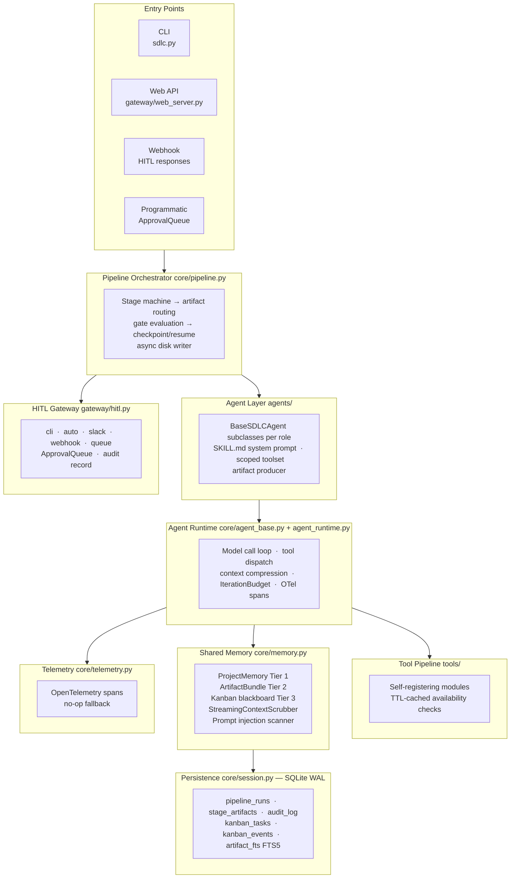
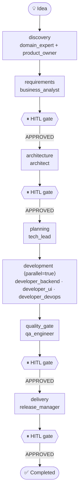
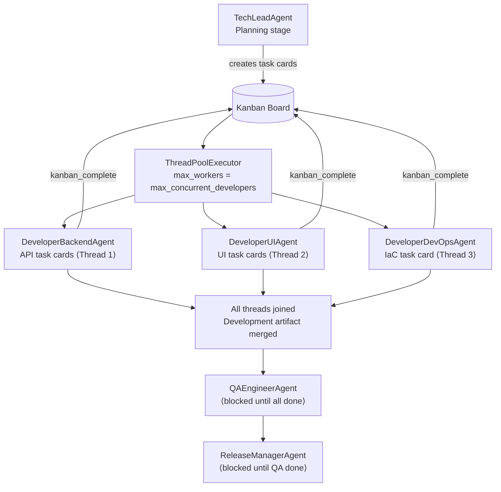
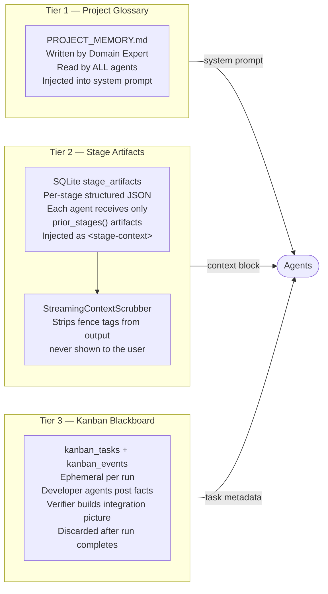
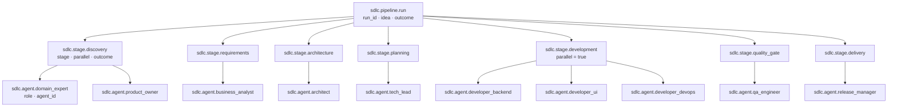

# SDLC Factory — Technical Architecture

## Layer Map



---

## Core Design Patterns

### 1. Agent-as-Role: the BaseSDLCAgent

Each specialist role is a thin subclass of `BaseSDLCAgent`. The base class adds:

- **Role identity** — a structured system prompt built from `SKILL.md` plus the
  role's authority statement and output contract.
- **Artifact contract** — a Pydantic model for what the agent must produce. The
  runtime validates the structured output before passing it to the next stage.
- **Scoped toolset** — read-only roles (Architect, BA) cannot call `terminal`;
  Developer roles have write access. Enforced at schema level.
- **Iteration budget** — each role has a configurable `max_iterations` cap via
  `IterationBudget`. Developer agents default 30; Architect defaults 50 (needs
  more reasoning turns).

```mermaid
classDiagram
    class BaseSDLCAgent {
        +ROLE str
        +ROLE_DISPLAY str
        +OUTPUT_SCHEMA dict
        +ENABLED_TOOLSETS list
        +SKILL_MD_PATH str
        +run(idea, bundle, run_id, stage, config)
        +prior_stages() list
        -_run_loop(system_prompt, messages, tools, budget)
        -skill_md() str
    }

    class DomainExpertAgent { toolset: web_search, read_file, memory }
    class ProductOwnerAgent { toolset: read_file, memory, write_file }
    class BusinessAnalystAgent { toolset: read_file, memory, write_file }
    class ArchitectAgent { toolset: read_file, web_search, write_file, memory }
    class TechLeadAgent { toolset: read_file, write_file, memory, kanban_create }
    class DeveloperBackendAgent { toolset: full_stack }
    class DeveloperUIAgent { toolset: full_stack + browser }
    class DeveloperDevOpsAgent { toolset: full_stack + terminal }
    class QAEngineerAgent { toolset: read_file, terminal, execute_code, write_file }
    class ReleaseManagerAgent { toolset: read_file, write_file, terminal }

    BaseSDLCAgent <|-- DomainExpertAgent
    BaseSDLCAgent <|-- ProductOwnerAgent
    BaseSDLCAgent <|-- BusinessAnalystAgent
    BaseSDLCAgent <|-- ArchitectAgent
    BaseSDLCAgent <|-- TechLeadAgent
    BaseSDLCAgent <|-- DeveloperBackendAgent
    BaseSDLCAgent <|-- DeveloperUIAgent
    BaseSDLCAgent <|-- DeveloperDevOpsAgent
    BaseSDLCAgent <|-- QAEngineerAgent
    BaseSDLCAgent <|-- ReleaseManagerAgent
```



### 2. Pipeline Orchestrator: Stage Machine

The pipeline is a **deterministic stage machine** with checkpoint semantics:



Each stage:
1. Receives the **accumulated artifact bundle** from prior stages (not raw
   conversation history — preserves context budget).
2. Runs its agent(s). Parallel stages use `ThreadPoolExecutor` with
   `max_concurrent_developers` workers.
3. Validates the structured output against the stage's artifact schema.
4. Evaluates the HITL gate (see below).
5. Persists the artifact + gate outcome to SQLite.
6. Advances state machine or halts for human input.

**Checkpoint resume**: on restart, the pipeline reads the last completed stage
from the DB and resumes from the next stage with the persisted artifact bundle.

### 3. Parallel Developer Dispatch: Kanban Swarm Topology

The development stage uses a swarm topology:



Each developer agent:
- Gets a **fresh message history** (no sibling context leak).
- Has its **own terminal session** (task_id scoped).
- Writes code to `output/src/<task_id>/`.
- Signals completion via `kanban_complete` with a metadata blob
  `{files_written: [...], tests_passing: bool, coverage: float}`.
- Parent dispatcher polls the board and triggers the verifier when all ready
  tasks reach `done` status.

### 4. Shared Memory: Three-Tier Context



### 5. HITL Governance

```mermaid
flowchart TD
    P[Pipeline] --> GATE["PipelineGate.evaluate\nstage, artifact"]

    GATE --> M{Gate mode}
    M -->|auto|    AE["AutoEvaluator\nCheck rule set\ncoverage threshold\nopen questions"]
    M -->|cli|     CL["Print artifact summary\nRead stdin y/n/edit"]
    M -->|slack|   SL["POST to channel\nPoll for reaction / reply"]
    M -->|webhook| WH["POST to URL\nPoll for response"]
    M -->|queue|   QU["Block on ApprovalQueue\nprogrammatic API"]

    AE & CL & SL & WH & QU --> DEC{Decision}

    DEC -->|APPROVED| ADV["Advance pipeline"]
    DEC -->|REJECTED| HALT["Halt run\nstatus = paused\nSurface to operator"]
    DEC -->|AMENDED|  AMD["Apply human edits to artifact\nClear downstream stages\nPartial re-run from this point"]

    ADV --> LOG[("audit_log\ntimestamp · actor · rationale")]
    HALT --> LOG
    AMD --> LOG
```

Outcomes are written to the `audit_log` table in SQLite:
`(pipeline_run_id, stage, decision, actor, timestamp, rationale)`.

### 6. Tool Registry: Self-Registration

Each tool module self-registers at import time:

```python
from core.registry import registry

registry.register(
    name="generate_requirements_doc",
    handler=generate_requirements_doc,
    schema={...},               # JSON Schema
    toolset="business_analyst",
    check_fn=lambda: True,
    emoji="📋",
)
```

`PipelineOrchestrator` calls `registry.get_definitions(enabled_toolsets=[...])`
to build the tool schema for each agent's role. Availability checks are
Availability checks are TTL-cached (30s) to avoid blocking the hot path.

### 7. Context Compression

Each agent's `ContextCompressor`:

- Triggers when token estimate > 80% of model context limit.
- Runs a cheap auxiliary model call to summarise middle turns.
- Protects the most recent 2,000 tokens (tail).
- Injects a structured `[STAGE COMPACTION]` prefix.
- Structured template tracks: `Resolved Requirements`, `Open Questions`,
  `Code Written`, `Remaining Work`, `Active Task`.

### 8. Security Model

| Layer | Mechanism |
|---|---|
| Input scanning | `scan_for_injection()` regex set applied before injecting idea/requirements |
| Path traversal | `validate_within_dir()` on all file writes; agents confined to `output/` workspace |
| Credential isolation | All API keys loaded from env; never written to artifact files |
| Subagent isolation | Developer agents cannot call `send_message`, `memory` (write), `delegate_task` (recursive) |
| Audit log | Every HITL decision, every tool call above risk threshold, logged with timestamp + actor |
| PII in logs | sender/user IDs SHA-256 hashed before log emission |
| Prompt injection | Idea text scanned via `scan_for_injection()` before first injection |

---

## Data Model (SQLite)

```sql
-- Pipeline runs
CREATE TABLE pipeline_runs (
    run_id       TEXT PRIMARY KEY,
    idea         TEXT NOT NULL,
    config_json  TEXT,
    status       TEXT DEFAULT 'running',  -- running | completed | failed | paused
    started_at   TEXT,
    completed_at TEXT,
    SCHEMA_VERSION INTEGER DEFAULT 1
);

-- Stage artifacts — one row per stage per run
CREATE TABLE stage_artifacts (
    id           INTEGER PRIMARY KEY AUTOINCREMENT,
    run_id       TEXT REFERENCES pipeline_runs(run_id),
    stage        TEXT NOT NULL,           -- discovery | requirements | ...
    artifact_json TEXT NOT NULL,          -- structured output from the stage agents
    status       TEXT DEFAULT 'pending',  -- pending | approved | rejected | amended
    created_at   TEXT,
    approved_at  TEXT,
    approved_by  TEXT
);

-- HITL audit log
CREATE TABLE audit_log (
    id           INTEGER PRIMARY KEY AUTOINCREMENT,
    run_id       TEXT,
    stage        TEXT,
    decision     TEXT,         -- APPROVED | REJECTED | AMENDED
    actor        TEXT,         -- cli:<user> | slack:<user> | auto
    rationale    TEXT,
    timestamp    TEXT
);

-- Kanban tasks for the development stage
CREATE TABLE kanban_tasks (
    task_id      TEXT PRIMARY KEY,
    run_id       TEXT,
    title        TEXT,
    assignee     TEXT,          -- developer_ui | developer_backend | developer_devops
    status       TEXT,          -- ready | in_progress | done | blocked
    metadata_json TEXT,
    created_at   TEXT,
    completed_at TEXT
);

-- Full-text search on artifacts
CREATE VIRTUAL TABLE artifact_fts USING fts5(
    run_id,
    stage,
    content,
    content='stage_artifacts',
    content_rowid='id'
);
```

---

## Message Protocol Between Agents

Agents do not call each other directly. All communication is mediated by the
pipeline's **artifact bundle** — a JSON dict accumulated across stages:

```json
{
  "run_id": "abc123",
  "idea": "Build a SaaS todo app with team sharing",
  "discovery": {
    "glossary": {"todo": "...", "team": "..."},
    "bounded_contexts": [...],
    "user_stories": [...],
    "mvp_scope": "..."
  },
  "requirements": {
    "brs_markdown": "...",
    "data_dictionary": [...],
    "process_flows": [...]
  },
  "architecture": {
    "adrs": [...],
    "c4_context": "...",
    "c4_container": "...",
    "tech_stack": {"backend": "FastAPI", "db": "PostgreSQL", ...}
  },
  "planning": {
    "tasks": [
      {"task_id": "t1", "title": "User auth API", "assignee": "developer_backend", ...},
      {"task_id": "t2", "title": "Login UI component", "assignee": "developer_ui", ...}
    ],
    "coding_standards": "..."
  },
  "development": {
    "t1": {"files": ["src/api/auth.py"], "tests_passing": true, "coverage": 87},
    "t2": {"files": ["src/ui/Login.tsx"], "tests_passing": true, "coverage": 92}
  },
  "quality_gate": {
    "test_plan": "...",
    "coverage_pct": 88,
    "bugs": [],
    "gate_passed": true
  }
}
```

Each agent receives this bundle injected as a `<stage-context>` block in its
system prompt, stripped from display by the streaming scrubber.

---

## Provider Strategy

| Role | Recommended model | Reason |
|---|---|---|
| DomainExpert, PO, BA | claude-sonnet-4-6 | Fast, good at structured text |
| Architect | claude-opus-4-7 | Complex reasoning, ADR quality |
| TechLead | claude-sonnet-4-6 | Good at task decomposition |
| Developer agents | claude-sonnet-4-6 | Code generation quality/cost |
| QA | claude-sonnet-4-6 | Test generation |
| Auxiliary (compressor) | claude-haiku-4-5 | Fast, cheap, context summarisation |

All models accessed via OpenAI-compatible interface (`base_url` + API key).
Provider failover uses `classify_api_error` + `jittered_backoff` retry logic.

---

## Observability

Every agent turn emits a structured JSON log line to `stdout` (see §14 of the Technical Guide for the full schema).

**OpenTelemetry span hierarchy** (optional, graceful no-op fallback):



---

## Extensibility: Adding a New Agent Role

1. Create `agents/security_reviewer.py` with a `SecurityReviewerAgent(BaseSDLCAgent)` subclass.
2. Create `skills/security-reviewer/SKILL.md` with role instructions.
3. Add a `Stage("security_review", agents=["security_reviewer"])` to `STAGES`.
4. Register any new tools in `tools/security_tool.py` via `registry.register(...)`.
5. Zero changes to core pipeline, registry, or memory system.

---

## Tech Stack

| Component | Choice | Reason |
|---|---|---|
| Language | Python 3.11+ | Rich async + threading; broad library support |
| LLM client | openai SDK (compatibility layer) | Provider-agnostic; works with any OpenAI-compatible endpoint |
| Persistence | SQLite WAL | Zero-dependency; FTS5 for artifact search |
| Concurrency | threading + ThreadPoolExecutor | Simpler than asyncio for CPU-bound tools |
| Config | YAML via PyYAML | Human-editable |
| Package | uv + pyproject.toml | Fast installs; reproducible environments |
| Testing | pytest + pytest-asyncio | Standard |
| CI | GitHub Actions | Standard workflow templates |
